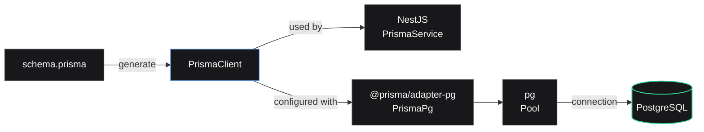

# Database Integration Recipe


## Architectural Rules

1. **Never import `PrismaModule` into feature modules:** It is decorated with `@Global()`. Simply inject `PrismaService` into any service constructor.

2. **Never instantiate `new PrismaClient()` in API code:** Always rely on the NestJS-managed `PrismaService` singleton to prevent connection pool exhaustion.

3. **Always project data using `select`:** Do not return un-sanitized raw database records that expose password hashes or internal metadata.


### Pattern 1: Standard Service Injection & Querying

```typescript
import { Injectable, NotFoundException } from '@nestjs/common';
import { PrismaService } from '@/common/prisma/prisma.service';

@Injectable()
export class UsersService {
  constructor(private readonly prisma: PrismaService) {}

  async findById(id: string) {
    const user = await this.prisma.user.findUnique({
      where: { id },
      select: {
        id: true,
        email: true,
        role: true,
        createdAt: true,
      },
    });

    if (!user) {
      throw new NotFoundException(`User with ID ${id} not found`);
    }

    return user;
  }
}
```

### Pattern 2: Interactive Atomic Transactions

When performing multi-table writes that must succeed or fail together, pass the transactional client (`tx`) across operations:

```typescript
import { Injectable } from '@nestjs/common';
import { PrismaService } from '@/common/prisma/prisma.service';

@Injectable()
export class EnrollmentService {
  constructor(private readonly prisma: PrismaService) {}

  async enrollStudent(userId: string, courseId: string) {
    return this.prisma.$transaction(async (tx) => {
      // 1. Create the enrollment record
      const enrollment = await tx.enrollment.create({
        data: { userId, courseId },
      });

      // 2. Increment active student count atomically
      await tx.course.update({
        where: { id: courseId },
        data: { enrolledCount: { increment: 1 } },
      });

      // 3. Write an immutable security audit entry
      await tx.securityAuditLog.create({
        data: {
          action: 'STUDENT_ENROLLED',
          targetId: enrollment.id,
          performedBy: userId,
        },
      });

      return enrollment;
    });
  }
}
```

### Pattern 3: Paginated Result Sets

Standardize cursor-based or offset pagination to keep memory usage bounded:

```typescript
async listAuditLogs(skip: number, take: number) {
  const [items, total] = await this.prisma.$transaction([
    this.prisma.securityAuditLog.findMany({
      skip,
      take,
      orderBy: { createdAt: 'desc' },
    }),
    this.prisma.securityAuditLog.count(),
  ]);

  return { items, total };
}
```